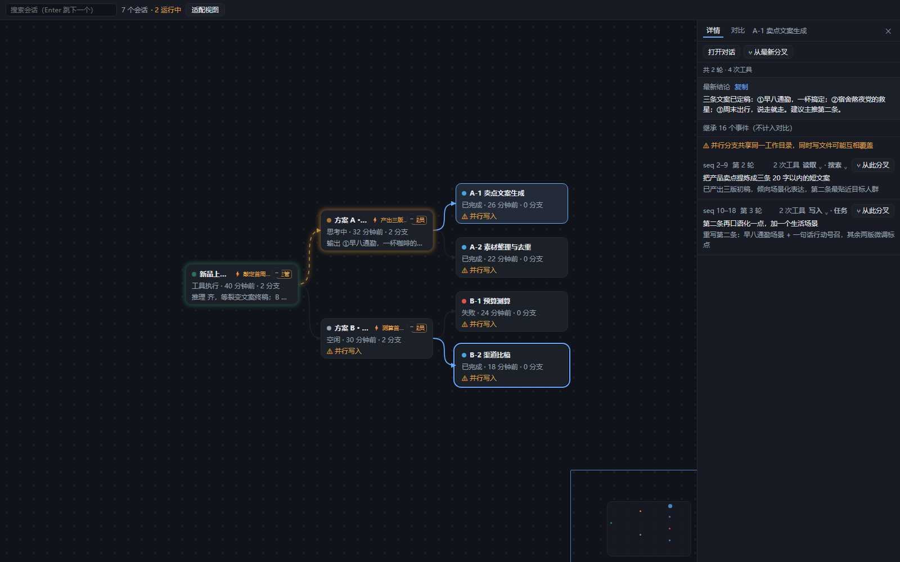
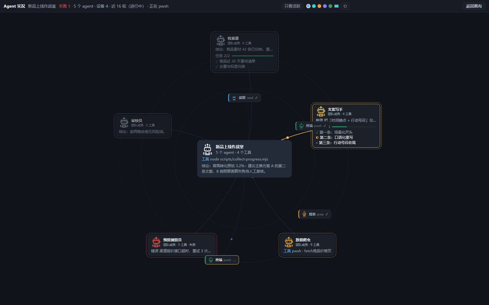

# dsh-canvas

[](https://github.com/answertsundere/dsh-canvas-plugin/actions/workflows/ci.yml)
[](LICENSE)

DeepSeek Harness 的会话分支画布插件：把当前工作区的会话血缘画成一张全幅画布，可以从任意一条消息分叉、并行跑两个方案、再确定性地对比它们。English readme: [`README.md`](README.md)。

| 血缘画布——任意消息分叉，分支实时可见 | Agent 实况蛛网——每个子代理在线工作，出活即亮 |
|---|---|
|  |  |

**不装也能玩**：[在线 Demo](https://answertsundere.github.io/dsh-canvas-plugin/) 用合成数据跑真实界面。本地：`pnpm run demo`，然后打开 `demo/index.html`。

> 目标版本：DSH `0.2.0-rc.2`。所有 DSH API 都是对着本地 checkout（commit `639ed01539`）核实的，不是对着线上文档。

## 它解决什么

DSH 原生支持会话分叉，侧边栏也能看到会话列表，但：

1. **分支关系看不见**——侧边栏把 fork 出来的子会话和普通会话平铺，父子血缘被丢掉；
2. **分叉入口太深**——只在侧边栏行菜单和聊天轮次尾部，看不到全局结构就没法规划"往哪分"；
3. **并行探索没有实况**——同时跑两个方案时，没法在一个画面里看各自进展、也没法对比结果。

## v1 能力

- **血缘画布**：工作区会话按 `parentSession` 建成左→右分层图，链式会话保持一条直线，分支才向下展开。可缩放（0.4–2×）、拖拽平移、适配视图、搜索定位。子代理是对话**内部**的关系，默认不进血缘图——父对话折叠成「机器人 ×N」徽章（点击直达 ⌖ 实况蛛网），工具栏「子代理」开关可把它们重新显示为节点。
- **从任意消息分叉**：详情面板逐条列出该分支自己的轮次，每行标注真实 `seq` 区间与「⑂ 从此分叉」。切点是这一行自己的最后一个事件序号——**永远是一个真实存在的事件**。
- **两种启动方式**：「立即开跑」把指令作为 `queue` 投给子会话；「只建分支」建一个空分支不发送任何东西。
- **确定性对比**：只比各自 `inheritedEventCount` 之后的新增事件，逐轮位置对齐，不比语义。「带回结论」生成**可编辑草稿**，绝不自动提交。
- **状态三态**：已确认（idle/queued/failed/done）、推断（thinking/tool）、未知（断线）。**绝不从沉默推断空闲。**
- **实时流式输出**：运行中的分支在画布上实时可见——节点卡显示正在生成的最新一行（推理／正文／工具），选中分支的详情面板显示完整的实时推理流与正文，逐 chunk 更新，落地后自动并入轮次列表。有流可见时状态徽章由流内容驱动（思考中／工具执行），运行中的节点不再是猜测。
- **Agent 实况蛛网**：点节点卡角上的「⌖」进入该会话的专属实况视图——父 agent 居中、子代理环绕成网。哪个 agent 在出活，哪个辐条就会亮起并有光点向父节点爬动（蜘蛛网效果），芯片上同步显示它正在生成的最新一行。子代理清单来自会话日志里的 `subagent/catalog` 事件，新 agent 出现即时上网，无需刷新。

## 环境要求

- DeepSeek Harness（桌面 App 或 CLI），锁定 `0.2.0-rc.2`——见[版本矩阵](#版本矩阵)
- Node.js ≥ 22.19、pnpm 10+（`corepack enable`）、Git

## 安装

一行命令，从 GitHub 直装（锁定发布 tag，无需构建）：

```sh
dsh plugin --profile <你的 profile> add "github:answertsundere/dsh-canvas-plugin#v0.1.0"
```

装完重启 App / profile——新增的 bundle 行只在 host 启动时读取。

从源码装（开发用）：

```bash
git clone https://github.com/answertsundere/dsh-canvas-plugin
cd dsh-canvas-plugin
pnpm install
pnpm run build
```

桌面版（推荐）：

```bash
node scripts/install-local.mjs --profile desktop
```

```bash
node scripts/install-local.mjs --profile desktop
```

独立 CLI **不能**用来装桌面 profile——它会硬拒 `--profile desktop`（`apps/cli/src/args.ts:83-87`），因为桌面 profile 的插件集合归 App 所有。脚本会自动改用 App 自带的 carrier CLI（`resources/runtime/cli/bin/dsh.cmd`，带 `manageDesktopProfile=true`）。

装完**需要重启 App**：新增的 bundle 行只在 host 启动时读取，HMR 只处理已有插件的代码变更。

Web profile（开发用）：

```bash
node scripts/install-local.mjs --profile web --repo <DSH checkout 路径>
dsh web --port 3090 --no-open
```

`--repo`（或环境变量 `DSH_REPO`）指向用于启动 DSH CLI 的 checkout，默认是维护者本机的 `D:/deepseek harness`。桌面路径不需要 checkout——它用的是 App 自带的 carrier CLI。

## v1 明确不做

| 限制 | 原因 |
|---|---|
| 分支共享同一工作目录 | 公开的 fork API 没有 `cwd` 参数，无法分叉到新目录。UI 常驻「⚠ 并行写入」告警。 |
| 详情面板是快照，不实时 | 选中节点时一次性读取并立刻释放 retain，保证不把会话钉住。 |
| 带回结论走剪贴板 | v1 没有 composer 句柄。 |
| 无持久主线标记 | 只叫「切换至此分支继续」。 |
| 无自动择优 / 无语义摘要 | 位置对齐是唯一能两次给出同一答案的规则。 |

## 版本矩阵

| DSH | 状态 |
|---|---|
| `0.2.0-rc.2` | 开发与验证目标 |

详见 [`docs/compat.md`](docs/compat.md) 与 [`docs/superpowers/m0-verification.md`](docs/superpowers/m0-verification.md)（M0 12 个关卡的实际结果，含未执行的关卡）。

## ⚠️ 发布前的已知阻塞

npm 上的 `dsh-canvas` **已被占用**（`0.0.1`，描述为 "Infinite canvas for the DeepSeek Harness - name reserved"，仓库 `dushaobindoudou/dsh-canvas`）。发布前必须改名为 `@<scope>/dsh-canvas`，并同步更新：

- `package.json` 的 `name`
- `cordis.patch.yml` 里的 `name:`
- `tsdown.config.ts` 的 `PLUGIN_ID`（决定 `window.__ModuleLoader__.load({ id })`）

在这个决定做出之前，本 GitHub 仓库就是分发渠道。

**不要在本地开发阶段改名**：`id` 一改，已装进 profile 的插件行就对不上，M0 验证过的安装会失效。

## 开发

```bash
env -u NODE_OPTIONS -u CODEBUDDY_SAFE_DELETE_BULK_GUARD node node_modules/vitest/vitest.mjs run
env -u NODE_OPTIONS -u CODEBUDDY_SAFE_DELETE_BULK_GUARD ./node_modules/.bin/tsdown
env -u NODE_OPTIONS -u CODEBUDDY_SAFE_DELETE_BULK_GUARD node scripts/install-local.mjs --profile desktop
env -u NODE_OPTIONS -u CODEBUDDY_SAFE_DELETE_BULK_GUARD node scripts/m0-check.mjs desktop
```

`env -u NODE_OPTIONS -u CODEBUDDY_SAFE_DELETE_BULK_GUARD` 不是装饰：宿主的 shim 会拦 pnpm 的 fs 操作，表现为零字节文件或 `EPERM rename`。

**接管这个项目（人或其他 AI 都算）：先读 [`HANDOFF.md`](HANDOFF.md)**——当前状态、 durable 知识分布、命令清单、静默失败的坑、待决策事项，一册齐。

两个会让改动**静默不生效**的坑，细节见 [`docs/superpowers/m0-verification.md`](docs/superpowers/m0-verification.md)：

1. `file:` 依赖是**拷贝**不是链接，且 spec/version 不变就跳过复制 → 重建后必须删掉 profile 里的副本再装（脚本已处理）。
2. pnpm 11 的 `pnpm-workspace.yaml` 里 `allowBuilds` 占位符没回答，`pnpm add` 会失败，而 DSH 的 plugin manager 会吞掉 pnpm 的 stderr。

## 参与贡献

环境搭建、验证流程与项目铁律见 [`CONTRIBUTING.md`](CONTRIBUTING.md)。欢迎提 bug——请附上 DSH 版本、操作系统、目标 profile，以及失败命令的完整输出。

## 许可证

MIT，见 [`LICENSE`](LICENSE)。
